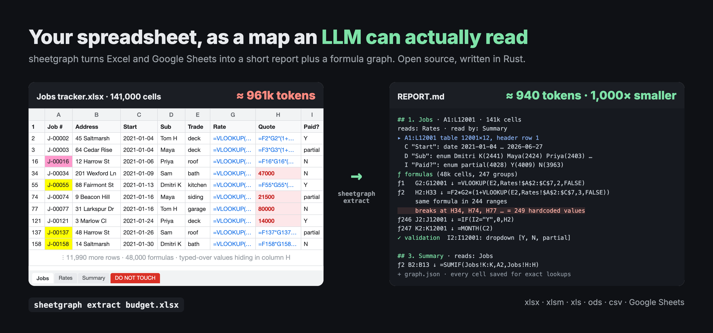

# sheetgraph

**Turn any spreadsheet into a map an LLM can read in one pass.**



sheetgraph extracts Excel and Google Sheets (xlsx, xlsm, xls, xlsb, ods, csv) into a short `REPORT.md` plus a **formula dependency graph**, and saves every cell alongside them so an agent can look up exact values when it needs to.

- **About 1,000× smaller.** The job tracker above is 141k cells, ≈961k tokens as a plain cell dump, and 940 tokens as a report. A real invoice ledger (120k cells, 32k formulas) comes out at ≈7k tokens instead of ≈1.3M.
- **Shows where a sheet breaks.** A formula column that someone typed over in 249 places is one line in the report, with exactly where the breaks are.
- **Follows the logic.** Sheet-to-sheet data flow, lookups, links to other workbooks, and `trace` for any cell's precedents and dependents.
- **One local binary.** Written in Rust. Local files never leave your machine, and up to 10 million cells are kept whole.

Made by [Love Spreadsheets](https://lovespreadsheets.com), which turns Google Sheets and Excel files into dashboards, CRMs, forms and other web apps, with a real engineer in the chat.

## Install

macOS and Linux:

```bash
curl -fsSL https://raw.githubusercontent.com/asharma327/sheetgraph/main/install.sh | sh
```

Windows: download `sheetgraph-x86_64-pc-windows-msvc.zip` from [Releases](https://github.com/asharma327/sheetgraph/releases/latest).

With Rust 1.88 or newer: `cargo install --git https://github.com/asharma327/sheetgraph`.

## Use it with your AI agent

sheetgraph ships as an agent skill, so your agent runs it on its own whenever you ask about a spreadsheet ("what does this workbook do?", "why is this total off?").

**Claude Code:**

```
/plugin install sheetgraph --marketplace asharma327/sheetgraph
```

**Codex, Cursor and other agents:** copy [`skills/sheetgraph/SKILL.md`](skills/sheetgraph/SKILL.md) into your agent's skills folder, or paste it into your `AGENTS.md`.

The skill installs the binary if it's missing, extracts the file, reads the report, and drills into exact cells with `cells` and `trace` before quoting numbers.

## Quick start

```bash
sheetgraph extract budget.xlsx      # writes sheetgraph-out/INDEX.md and sheetgraph-out/budget/
```

Then open `sheetgraph-out/budget/REPORT.md`, or point your AI agent (Claude Code, Cursor, Codex) at `sheetgraph-out/INDEX.md`. See [Giving it to an AI agent](#giving-it-to-an-ai-agent).

> **Beta (0.1).** It works on real-world files, but the report format and the library API may still change between releases. Bug reports are welcome: see [CONTRIBUTING.md](CONTRIBUTING.md).

## Why it's small

A spreadsheet is mostly repetition. sheetgraph keeps the information and drops the repetition:

| Raw | Becomes |
|---|---|
| 3,541 cells `=MONTH(A2)`, `=MONTH(A3)`, … | one **copy-group**: `ƒ1 B2:B3542 ↓ =MONTH(A2)` (formulas grouped by R1C1 form, merged into rectangles) |
| the same lookup in 24 ranges interrupted by typed-over values | one line + *where it breaks and what's in the breaks* (`462 hardcoded values`) |
| 35k rows of data | header + per-column profile (type, range, enum values, number format, which ƒ computes it) + 4 sample rows |
| 2,000 date columns of the same shape | `D…BXZ (2,000 alike) "2021-09-01" … "2026-10-22": ƒ12; num …` |
| per-cell formats / validations | rectangles per distinct style / rule |

On an invoice ledger (120k cells, 32k formulas): **REPORT.md ≈ 7k tokens vs ≈ 1.3M tokens** for a plain cell dump. The job tracker in the image above is generated by [`assets/make_demo_xlsx.py`](assets/make_demo_xlsx.py) if you want to reproduce it.

Inspired by [graphify](https://github.com/Graphify-Labs/graphify) (overview report → scoped queries → full graph), but for spreadsheets.

## What a report looks like

An excerpt from `tests/fixtures/features.xlsx`:

```text
## 1. Data · A1:G21 · 127 cells · frozen 1r0c
read by: Summary
▸ A1:G21 table 21×7 (127 cells), header row 1
  A "Date": date 2026-01-05 … 2026-05-18 (20 filled)
  B "Region": enum East(5) North(5) South(5) West(5) (20 filled)
  E "Price": num 2.5 … 21.5 fmt $#,##0.00 (20 filled)
  F "Revenue": ƒ1 (20 filled)
ƒ1 F2:F21 ↓ =D2*E2
✓ validation
B2:B21: dropdown [North, South, East, West]
D2:D21: WHOLE_NUMBER_BETWEEN 0, 1000 (strict) help: "Units: Whole units, 0-1000"
◐ conditional formats
F2:F21: cell lessThan 0 → bg#FFC7CE fg#9C0006
table Sales A1:F21 [Date, Region, Product, Units, Price, Revenue]

## 3. Summary · A1:B11 · 13 cells · tab #FF0000
reads: Data (2g), Lists (1g)
ƒ1 B1 =SUM(Sales[Revenue])
ƒ4 B4 ='[Rates.xlsx]Rates'!B2*2 [external]
chart column "Revenue by week" ← 'Data'!F1, 'Data'!A2:A21, 'Data'!F2:F21
```

## Usage

`sheetgraph-out/budget/REPORT.md` is the map: sheets, tables with column profiles, formula groups and how sheets feed each other. Pass several files (and Google Sheets) at once, and `-o <dir>` to write somewhere else.

```bash
# Google Sheets (ids or URLs) and/or local files, mixed
sheetgraph extract <id|url|file.xlsx>... -o sheetgraph-out --creds service-account.json

# drill down (all read workbook.json.gz; no network)
sheetgraph cells  sheetgraph-out/<wb> "'Revenue Input'!A1:F20"
sheetgraph trace  sheetgraph-out/<wb> "Monthly!E10" --depth 3   # precedents + dependents, into other extracted workbooks too
sheetgraph find   sheetgraph-out/<wb> "VAT"                      # values, formulas, notes, comments, macro code
sheetgraph macro  sheetgraph-out/<wb> [Module1 | RollUp]         # macros and what they touch; code with a name
sheetgraph sheet  sheetgraph-out/<wb> "Ledger" --full           # untruncated section
sheetgraph report sheetgraph-out/<wb> [--full]                 # re-render without refetching
```

Local files need no credentials. For Google Sheets, credentials are tried in order: `--creds`, `$SHEETGRAPH_TOKEN` (raw access token), `$GOOGLE_APPLICATION_CREDENTIALS`, gcloud ADC (`gcloud auth application-default login`). Service accounts need the sheet shared with their email.

As a library:

```rust
let auth = sheetgraph::gsheets::Auth::discover(Some("sa.json"))?;
let wb = sheetgraph::load("<spreadsheet id or URL>", Some(&auth), false)?; // or a local path, with auth None
let a = sheetgraph::analyze::analyze(&wb);
let md = sheetgraph::report::render(&wb, &a, &Default::default());
let graph = sheetgraph::graph::build(&wb, &a); // serde_json::Value
```

## Output

```
sheetgraph-out/
  INDEX.md                    every workbook, sizes, links between workbooks (IMPORTRANGE, Excel external links)
  <workbook>/REPORT.md        the map: read this first
  <workbook>/graph.json       nodes (sheets, blocks, formula groups, charts, pivots, dropdowns and rules, names, externals, macros) + edges
  <workbook>/workbook.json.gz every cell (see Known gaps for very large files): value, formula, display text, style, validation, note, link; plus column widths, row heights and file comments
  <workbook>/meta.json
```

REPORT.md contains, per workbook: sheet list with used ranges and sheet→sheet data flow; external links (IMPORTRANGE / IMPORTDATA / … with targets resolved from cells, Excel links to other workbooks, refs to deleted sheets, Connected-Sheets data sources); dropdowns, validation and conditional formats that read another sheet; named ranges, with the sheet a local name belongs to and which names are LAMBDA functions; function census incl. **non-builtin functions** (Apps Script custom functions / Named Functions / VBA UDFs), dynamic refs (INDIRECT/OFFSET) and volatile functions; scripts (VBA modules from xlsm; Apps Script on request), with each procedure's trigger (`Workbook_Open`, `Worksheet_Change`, `onEdit`), the sheets and ranges it writes and uses, the procedures it calls, and the formula cells that call it as a function; modules with no code (the empty one Excel gives every sheet) are counted, not listed; developer metadata (left by add-ons/integrations).

REPORT.md also starts with what changes how the whole file behaves: document properties, calculation mode (manual calculation means stored values may be stale; iterative means circular references are intended), a locked sheet structure, and data connections and Power Query code.

graph.json edges: `reads` (formula group → the blocks and groups its references land on), `plots` (chart → source), `summarizes` (pivot → source), `imports` (formula → external workbook or URL), `writes` / `uses` (macro → what it changes or reads; a sheet the macro creates has `"to": null` and `missing_sheet`), `calls` (macro → macro, and formula group → the VBA function it calls), `runs` (button or shape → the macro it runs), `writes` from a form control to its linked cell, `choices` (dropdown → the range its list comes from), and `reads` from validation and conditional-format rules and from names defined by a formula (LAMBDA included) to what they read. A formula reading a name defined by a formula gets `reads` edges to what that formula reads, with `via` naming it; a name local to one sheet is the node `name:Sheet!Name`.

Per sheet: blocks (tables with column profiles + samples, or small blocks verbatim), formula copy-groups and families with flags (`[array/spills]`, `[external]`, `[dynamic ref]`, `[#REF!]`, error counts, reads of a cell hidden under a merge), data validation (dropdowns, checkboxes, range-sourced lists), conditional formats, visual formatting regions (with named cell styles such as "Input" and which sides have a border), merges (repeats folded into patterns), filters/filter views and slicers, protected ranges, hidden rows/cols, banding, Excel tables, charts and pivots (with source ranges), pictures, shapes, text boxes and buttons over the grid (with their text and the macro they run), pictures in cells and data types (Excel Stocks/Geography, Google people and file chips), text with mixed formatting, unlocked input cells and hidden formulas, notes and comments with their authors, hyperlinks, grouped rows and columns (collapsed or not), and whether gridlines are off. Column widths and row heights are kept in workbook.json.gz only; a zero width or height counts as hidden. Google Drive comments (with replies and whether they're resolved) get their own section.

## Giving it to an AI agent

Point the agent at `INDEX.md`, then the `REPORT.md` it needs, and let it run the drill-down commands for exact cells. Notation it should know:

- `ƒN` is formula copy-group N of a sheet. The formula is shown at the group's top-left cell and copied over the range with relative refs shifting: `↓` filled down, `→` across, `▦` both.
- "same formula in N ranges … breaks at X = K hardcoded values" means a formula column was typed over in places. Those breaks are often where numbers stop matching expectations.
- "typed arithmetic" is hand-entered sums like `=3820+3770`: data entry, not logic.
- `▸ range table …` is a data block, one line per column: type and range, `enum` for small value sets, `fmt` for the number format, `ƒN` when the column is computed.
- "same layout as X" means a sheet is a structural clone of an earlier one with different data; `sheetgraph sheet <dir> "<name>" --full` shows it in full.
- `[reads B8 inside merge A8:C8: blank]` flags a formula pointing at a cell a merge hides: it always reads blank, usually a mistake for the merge's top-left cell.
- `⋯ rows A–B summarized` means a very large sheet's middle rows were summarized per column rather than kept: the column profiles still count every row, but sample rows and `cells` don't show those rows.
- Flags: `[external]` another file, `[dynamic ref]` INDIRECT/OFFSET (graph edges incomplete), `[array/spills]`, `[#REF!]`, `[N errors]`.
- Under Scripts, `RollUp: writes Summary!A1:B1,B2:B5 · uses Data!E10,… · calls Totals` is one procedure. `,…` means it also reaches cells whose address is built at run time (`Cells(i, 2)`); `(not in file)` is a sheet the macro creates; `ActiveSheet` is whichever sheet is active when it runs. `sheetgraph macro <dir> RollUp` prints its code.

## Layout

| module | role |
|---|---|
| `model` | source-agnostic full-fidelity workbook (sparse cells, deduped styles/validations) |
| `gsheets` | auth (service account JWT / ADC refresh / token), chunked parallel grid fetch with retry, conversion, Drive comments |
| `xlsx` | calamine: values, formulas, defined names, merges, VBA; csv |
| `ooxml` | xlsx/xlsm package parts calamine skips: styles, validation, conditional formats, comments and their authors, hyperlinks, frozen/hidden rows and cols, column widths, row heights, outline groups, gridlines, filters, protection, tables, charts, pivots, external workbook links, rich text, pictures and data types in cells, shapes and form controls, document properties, calculation settings, connections, Power Query |
| `numfmt` | Excel number formats applied to numbers (`25%`, `$12.50`) |
| `formula` | reference lexer (quoted and non-English sheet names, open-ended `A2:A`, whole rows/cols, `'[Book.xlsx]Sheet'`), R1C1 keys, function census |
| `analyze` | copy-groups, families, blocks, cross-sheet edges, externals, names, dropdown and rule refs |
| `macros` | VBA / Apps Script procedures: triggers, sheets and ranges each writes and uses, calls |
| `report` | REPORT.md |
| `graph` | graph.json |
| `query` | cells / trace / find / macro |
| `store` | on-disk layout, INDEX.md |

## Known gaps

- **Apps Script / macros / add-ons on Google Sheets**: the Sheets API doesn't expose bound scripts, installed add-ons or triggers, and the Apps Script API doesn't work with service accounts. `--apps-script <scriptId>` fetches a project with user OAuth (scope `script.projects.readonly`). Custom functions are still detected from formulas.
- **Local files**: xlsx/xlsm get the same coverage as Google Sheets, plus Excel tables, links to other workbooks (`'[Budget.xlsx]Data'!B2`), shapes and pictures, connections and Power Query. Sparklines, Excel slicers and ActiveX controls aren't read (the report says when a file has them). xls, xlsb and ods get values, formulas, names and merges only.
- **Comments on Google Sheets**: the Drive API doesn't say which cell a comment is on, only the text that cell showed. A comment is placed on a cell only when exactly one cell shows that text; otherwise REPORT.md lists it with the text it quotes.
- **Pictures on Google Sheets**: the Sheets API doesn't return pictures placed over the grid or inserted into cells (an `=IMAGE()` formula is kept).
- Number-format display text covers the common formats (percent, currency, thousands, decimals, scientific, sections); fractions, conditional sections and formats that mix digits with literals (`000-00-0000`) show the plain value. The format itself is on every cell.
- Spill ranges of array formulas are flagged on the formula but the spilled cells look like plain values.
- **What a macro touches** is read from its code, not by running it: literal addresses, sheets held in variables, `With` blocks, sheets passed to other procedures, code names, string constants and named ranges are followed; an address built at run time counts as the whole sheet, and a sheet picked at run time (from a cell, a loop over all sheets) isn't known. Apps Script code is listed by function without the ranges it touches.
- INDIRECT/OFFSET targets are dynamic, so those edges are missing (flagged in the report).
- **Very large local files**: up to 10 million cells are kept whole (about 0.2–0.4 GB of memory per million). Past that, a big sheet keeps its last 1,000 rows and its formulas, and summarizes the rows in between per column (counts, min and max, most common values; no sums), so memory stays near 2–3 GB however big the file is (a 160 MB xlsx with 44 million cells: 3 GB, 84 s). REPORT.md's column profiles still count every row and say which rows were summarized; `cells` only lists kept rows, and `find` reports text matches in summarized rows by column. The budget is `xlsx::CELL_BUDGET`; `xlsx::read_limited` takes another.
- **Very large Google Sheets** are read whole, without that budget. Google allows up to 20 million cells, so a sheet near the limit can take several GB of memory.

## Development

```bash
cargo test
```

`tests/fixtures/features.xlsx` exercises every xlsx feature the reader handles. It is generated by `tests/fixtures/make_features.py` (openpyxl 3.1.5); rerun the script after changing it. `tests/fixtures/macros.xlsm` is the VBA fixture, generated the same way by `tests/fixtures/make_macros.py`, which also writes its VBA project from scratch.

See [CONTRIBUTING.md](CONTRIBUTING.md) before opening an issue or pull request, and [SECURITY.md](SECURITY.md) to report a vulnerability.

## Love Spreadsheets

sheetgraph comes from [Love Spreadsheets](https://lovespreadsheets.com). Describe what you need in a chat, and it builds a dashboard, CRM, form, calculator, project tracker or website from your Google Sheets and Excel files, with no coding.

## License

Licensed under either of [Apache License, Version 2.0](LICENSE-APACHE) or [MIT license](LICENSE-MIT) at your option.

Unless you explicitly state otherwise, any contribution intentionally submitted for inclusion in this project by you, as defined in the Apache-2.0 license, shall be dual licensed as above, without any additional terms or conditions.
